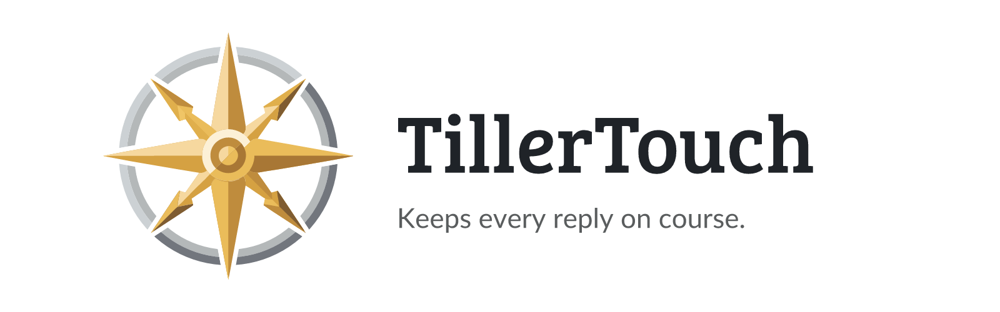

<p align="center">
  <picture>
    <source media="(prefers-color-scheme: dark)" srcset=".github/assets/banner-dark.png">
    
  </picture>
</p>

<p align="center">
  <a href="#3-install"></a>&nbsp;
  <a href="LICENSE"></a>
</p>

<br>

<p align="center">
A <b>second look</b> at your coding assistant's tool calls and replies.<br>
<br>
Before a tool call runs and before a turn ends, a model looks at it. If the call walks past a clearly better tool, or
the reply names a gap and leaves it open, asks you to approve something it never showed you, or skips a better
way, TillerTouch sends it back once with a one-line note and the assistant fixes it. Everything else goes through
untouched. It runs on every turn, or only when you write <b>2B</b> in your message.<br>
<br>
The name comes from sailing: a light touch on the tiller is enough to bring the boat back on course.
</p>

<br>

<p align="center">
  <a href="https://buymeacoffee.com/junkerderprovinz"></a>
  &nbsp;
  <a href="https://www.paypal.com/donate/?hosted_button_id=76FVV52TKXTUS"></a>
  &nbsp;
  <a href="https://junkerderprovinz.github.io/junkerderprovinz/"></a>
</p>

<br>

## Table of Contents

1. [What it does](#1-what-it-does)
2. [The three checks](#2-the-three-checks)
3. [Install](#3-install)
4. [Codex CLI, Gemini CLI, Qwen Code and Factory Droid](#4-codex-cli-gemini-cli-qwen-code-and-factory-droid)
5. [Configuration](#5-configuration)
6. [Cost](#6-cost)
7. [Limits](#7-limits)
8. [Testing](#8-testing)
9. [How AI is used here](#9-how-ai-is-used-here)
10. [Support this project](#10-support-this-project)

<br>

## 1. What it does

TillerTouch adds three hooks to your coding assistant. This section and the next two describe them in Claude Code;
[section 4](#4-codex-cli-gemini-cli-qwen-code-and-factory-droid) covers the other tools.

On every prompt it adds a short note to the context: before taking the obvious route, check whether a better
method, a fitting tool, an installed skill, plugin or MCP server, or a helper that already exists in the project
would do the job better, and if so, say it first in a sentence or two. This part makes no model call of its own. A
second call on every prompt would add a wait and a bill, and only the main session knows which skills, plugins and
tools are installed, so the main session is the one that has to look.

Before each tool call, a command hook on the `PreToolUse` event asks a model whether a clearly better way exists
for that call, for example a formatter instead of hand edits, or a JSON parser instead of a regular expression. If
so, the call is denied with the reason, and Claude either uses the better way or says why not and repeats the call.
A call that was sent back once always goes through the second time.

When a turn ends, a command hook on the `Stop` event reads the final reply and decides whether it can stand. If one
of the three checks below fails, the reply goes back to Claude with the reason, and Claude continues the same turn
with a short follow-up. A reply that already went back once in a turn always passes, so a single reply is never
sent back twice.

Both checks run in the mode you pick. In `demand` mode, the default, they run only in a turn whose prompt contains
the word `2B`, such as "Add retries to the upload client, 2B". The next prompt without it runs nothing. In
`permanent` mode every call and every reply is checked. The note on each prompt runs in both modes, and in a turn
with `2B` it tells Claude that the word is your signal and not part of the task.

<br>

## 2. The three checks

### A gap with no way to close it

The reply says something is untested, missing, never ran, unknown or not verified, and stops there. It passes as
soon as it names a test, a fix, or a plan with a recommendation, or says the assistant does it now. It also passes when it
explains why the gap cannot be closed from here and tells you the next step.

> I added retry logic to the upload client. The timeout path is untested and I have not verified it against the real server.

Sent back with: *TillerTouch (gap): the reply says "The timeout path is untested" but gives no test or plan to
close it. Name a concrete way to test the timeout path.*

### Asking for approval without showing what to approve

The reply asks you to approve a text to post, a release, a commit or a change, but the text, the notes or the diff
are not in the same message.

> The release notes for 2.3.0 are ready. Shall I publish the release?

Sent back with: *TillerTouch (approval): the reply asks "Shall I publish the release?" but the release notes are
not shown. Include them before asking for the go.*

### A clearly better way it did not mention

The reply describes how the work was done, and a clearly better method, tool, skill or existing helper fits the
task, but the reply does not mention it. Matters of taste do not count.

> I went through all 63 Go files and fixed the indentation and spacing by hand so they match standard Go style.

Sent back with: *TillerTouch (better way): `gofmt -w .` does this in one command and is the obvious tool. Say so.*

The full prompts are in [`hooks/judge-prompt.txt`](hooks/judge-prompt.txt) for the reply and
[`hooks/tool-prompt.txt`](hooks/tool-prompt.txt) for a tool call. `node scripts/sync.mjs` copies them into the
packages for the other tools.

<br>

## 3. Install

The repository is its own plugin marketplace. In Claude Code:

```text
/plugin marketplace add junkerderprovinz/tillertouch
/plugin install tillertouch@tillertouch
```

Or from a shell:

```sh
claude plugin marketplace add junkerderprovinz/tillertouch
claude plugin install tillertouch@tillertouch
```

To try it without installing, clone the repository and start Claude Code with `claude --plugin-dir path/to/tillertouch`.
`/plugin` turns it off again.

<br>

## 4. Codex CLI, Gemini CLI, Qwen Code and Factory Droid

TillerTouch runs in these four as well, with the same note on every prompt and the same three checks from the
same prompt file. How the check gets made differs.

Qwen Code reads the Claude Code plugin and gets the note on every prompt. The checks start the `claude` CLI, so
without it they let everything through. In all four tools,
[`scripts/tillertouch.mjs`](scripts/tillertouch.mjs) starts a second, headless run of the same CLI with a small
model, hands it the reply together with the check's prompt, and sends the reply back if the answer says so. That needs Node.js 18 or
newer on the path. If the second run fails, takes longer than 90 seconds or answers something the script cannot
read, the reply goes through.

| Tool | Check at the end of the turn | Model for the check | How far it is tested |
| :- | :- | :- | :- |
| Claude Code | `claude -p` in the hook | `opus`, set with the `model` option | live, with the samples |
| Qwen Code | none, the note only | none | the note only |
| Codex CLI | `codex exec` in the hook | `gpt-6-luna`, low reasoning effort | end to end against a stand-in model server |
| Gemini CLI | `gemini -p` in the hook | `flash-lite` | end to end against a stand-in model server |
| Factory Droid | `droid exec` in the hook | `claude-haiku-5-5` | install, and the script offline |

The stand-in server answered like a model would, so these runs prove the hooks load, the note arrives, a reply goes
back and the turn continues. They say nothing about how well each tool's model judges. For Codex, Gemini and Droid
the second run sees only the reply (and in Gemini also your prompt), not the whole conversation.

### Codex CLI

```sh
codex plugin marketplace add junkerderprovinz/tillertouch
codex plugin add tillertouch@tillertouch
```

Codex reads the same marketplace file as Claude Code and takes its hooks from [`codex/hooks.json`](codex/hooks.json).
It runs no plugin hook until you trust it, so open `/hooks` once and trust both. `codex exec` needs that trust as
well, or `--dangerously-bypass-hook-trust` for a run you have vetted yourself. The second run uses your Codex login,
a read-only sandbox and no hooks. On Windows, Codex ran the hook commands in Git Bash during testing. I have not
tried it on a machine without Git Bash.

### Gemini CLI

Gemini CLI installs an extension from the root of a repository, and the root here belongs to the Claude Code
plugin. The extension lives in [`gemini/`](gemini) and installs from a clone:

```sh
git clone https://github.com/junkerderprovinz/tillertouch
gemini extensions install ./tillertouch/gemini
```

The note goes in on `BeforeAgent` and the check runs on `AfterAgent`. A reply that goes back shows as `Agent
execution blocked: TillerTouch (...)`, and Gemini tries again with the reason. The second run loads no extensions,
stays in plan mode and skips the folder trust check, since it runs in an empty temporary folder.
`gemini extensions config tillertouch` switches the note off or changes its wording.

### Qwen Code

```sh
qwen extensions install https://github.com/junkerderprovinz/tillertouch:tillertouch
```

Qwen converts the Claude Code plugin into an extension and runs both hooks unchanged. The check uses the model of
your session: the hook file is shared with Claude Code, so it cannot name a Qwen model. Qwen has no plugin options,
so the note follows the environment variables below.

### Factory Droid

```sh
droid plugin marketplace add https://github.com/junkerderprovinz/tillertouch
droid plugin install tillertouch@tillertouch --scope user
```

Droid reads [`.factory-plugin/marketplace.json`](.factory-plugin/marketplace.json), which points at
[`factory/`](factory). Its `Stop` hook gets no reply text, only the path to the session transcript, so the script
takes the last assistant message from that file. Factory does not document the transcript format, and `droid exec`
needs a Factory login, which the tests so far did not have, so this is the least tested of the five. If the script
finds no reply, it lets the turn end.

### Settings for the other tools

| Variable | What it does |
| :- | :- |
| `TILLERTOUCH_PROMPT_NUDGE` | `false` stops the note on every prompt. |
| `TILLERTOUCH_PROMPT_NUDGE_TEXT` | Replaces the wording of the note. |
| `TILLERTOUCH_MODE` | `demand` runs the check only for a prompt that contains `2B`. Without it, every turn is checked. |
| `TILLERTOUCH_MODEL` | Uses another model for the second run. |
| `TILLERTOUCH_TIMEOUT` | Seconds the second run may take, 90 by default. |
| `TILLERTOUCH_DEBUG` | Writes to stderr why a reply went through, so a failed check can be told from a passed one. |

The packages for Gemini and Droid install as their own folders, so they carry copies of the shared files.
`node scripts/sync.mjs` refreshes them, and the tests fail when a copy is out of date.

<br>

## 5. Configuration

Change the options with `/plugin configure tillertouch@tillertouch`, or in `/config`, where every enabled plugin
lists its options. Until you set them, the defaults apply.

| Option | Default | What it does |
| :- | :- | :- |
| `mode` | `demand` | `demand` checks tool calls and the reply only in a turn whose prompt contains `2B`. `permanent` checks every call and every reply. |
| `model` | `opus` | The model for the checks, for example `opus`, `sonnet` or `haiku`. A smaller one is faster and cheaper but misses more, so it suits `permanent` mode better. |
| `prompt_nudge` | `true` | Adds the note to every prompt. Set it to `false` to keep only the check at the end of the turn. |
| `prompt_nudge_text` | empty | Replaces the wording of the note. Empty keeps the default from [`hooks/prompt-nudge.txt`](hooks/prompt-nudge.txt). |

Claude Code stores the answers under `pluginConfigs` in your user settings file:

```json
{
  "pluginConfigs": {
    "tillertouch@tillertouch": {
      "options": {
        "prompt_nudge": true,
        "prompt_nudge_text": "Before you start, check whether a tool this project already uses fits better."
      }
    }
  }
}
```

To pause the checks completely, set `mode` to `demand` and leave `2B` out of your prompts, or turn the plugin off
with `/plugin`.

<br>

## 6. Cost

The note on each prompt costs no model call, only about 80 tokens of context.

Every check is **one headless `claude -p` run** on the model from the `model` option, Opus by default. The check at
the end of the turn sends the reply and your prompt, about 1,000 to 1,500 input tokens. The check before a tool call
is one run per call and sends the tool name and its input, so a large write costs more. In `demand` mode that
happens only in turns with `2B`. In `permanent` mode a task with 30 tool calls means 30 runs, each adding the start-up
of the CLI and a model call to the wait, so a smaller model is the better fit there. A reply or call that goes back
adds a short follow-up from your main model.

In Codex CLI, Gemini CLI and Factory Droid the check is a second headless run on the small model from the table
in [section 4](#4-codex-cli-gemini-cli-qwen-code-and-factory-droid), billed to the same account as the session.
It sends only the check's prompt and the reply, so it stays small. Qwen Code makes the check on the model of your
session, which usually costs more than a small one would.

<br>

## 7. Limits

- Claude Code shows a reply while it is being written, so the check cannot hold it back. You see the reply first
  and the follow-up right after it, in the same turn.
- The checks see the reply or the single call, not the whole conversation. A smaller model will miss some and send
  back a few it should have let through, which is why the prompts tell it to let things pass when in doubt.
- Only the main conversation is checked, not the reports of subagents.
- The hooks need Node.js 18 or newer and the `claude` CLI on the path. Without either, nothing is checked and
  everything goes through.
- There is no hook after edits. The check before a call sees what is about to run, not what it did.
- In Codex CLI, Gemini CLI and Factory Droid the check starts the same CLI a second time, and that start-up comes
  on top of the model call. You wait for both at the end of every turn.

<br>

## 8. Testing

[`test/run.mjs`](test/run.mjs) starts a headless Claude Code session per sample in
[`test/samples.json`](test/samples.json), with TillerTouch loaded and your own settings and hooks left out. The
session repeats the sample as its reply, the check runs on it, and the script prints the decision, the reason and
the follow-up. It also checks that the prompt note is added, can be switched off and can be reworded. The session
runs in `permanent` mode on Haiku, so the samples do not depend on the `2B` word.

```sh
node test/run.mjs                  # offline checks, then every tool on the path
node test/run.mjs claude gap       # only Claude Code, only the gap sample
node test/run.mjs offline          # no model at all
```

It needs Node.js and a logged-in `claude` on the path (`CLAUDE_BIN` points it elsewhere). Each sample is one short
session on Haiku plus the check, so a full run costs a few cents and takes about a minute.

Before that, the offline checks run the script for the other tools against
[`test/fake-cli.mjs`](test/fake-cli.mjs), a stand-in for `claude`, `codex`, `gemini` and `droid`: a reply goes back,
a pass or a broken answer lets it through, a slow judge times out, a reply is never judged twice, a tool call is
denied once and then let through, `demand` mode judges only a prompt with `2B`, and the second run gets the small
model and has its own hooks off. They also check that every copy matches the shared files and that each
hook file uses only its own tool's event names. When `codex`, `gemini` or `droid` is on the path, the samples then
run through the script with the real CLI and your login for it.

<br>

## 9. How AI is used here

TillerTouch is built on a model: every check at the end of a turn is a call to one, made by Claude Code, or by
the other tool you run it in, on your account. That is the point of the plugin, and it is why the [cost](#6-cost) section exists.

The code and this README were also written with help from an AI assistant, the same way I work with an editor or a
compiler. I read and understand everything before it ships, and if something here is wrong, that is on me. If you
find something that is not right, open an issue and I will look at it.

<br>

## 10. Support this project

Bugs, ideas or feature requests? Please [open a GitHub issue](https://github.com/junkerderprovinz/tillertouch/issues).

A one-knight job: I build it, keep it running, work through the issues and add what people ask for. It is free,
with no accounts, no telemetry, no ads and no paid tier. If it has earned a place in your setup, toss a coin to
your knight with one of the buttons at the top.
